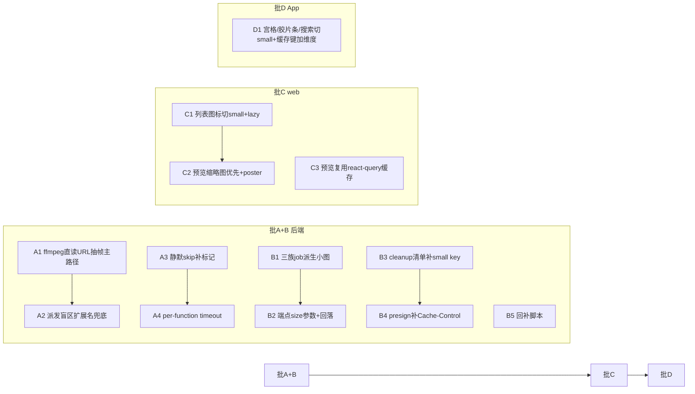

# 方案：大视频封面补全 + 小尺寸缩略图变体 + web 预览缩略图优先

> 2026-10-27 定稿目标。覆盖三个问题：①生产环境大量大体积视频无封面缩略图；②1024px 单一规格无法满足列表/宫格小图标的高性能展示；③web 预览每次打开都拉原图并产生签发审计。
> 前置调研：`rushes-spec/material-storage/heic-mov-preview-thumbnail-investigation.md`（2026-10-15，§2.4 已论证「ffmpeg 直读 presigned URL」路线，本文将其落地为可实施方案）。
> 状态：**已定稿**（qplan 盲审 8 轮收敛：第 8 轮 0 P0 / 0 P1；历轮累计修复 8×P1 + 43×P2），未动代码，实施等用户指令。

## TL;DR

| 问题 | 根因 | 方案 | 批次 |
| --- | --- | --- | --- |
| 大视频无封面 | `_VIDEO_THUMBNAIL_MAX_BYTES=50MB` 超限静默 `skip_too_large`；另有派发只认 content_type 前缀的盲区 | 新增 ffmpeg 直读 presigned URL 的抽帧主路径（传输量与文件大小无关），per-function timeout 提额，修派发盲区，存量回补 | **批 A（后端）** |
| 列表/宫格图标用 1024 图 | 全仓唯一规格 `_THUMBNAIL_MAX_PX=1024`，web 图标实渲染 32/44px、App 宫格 cell ≈110dp，解码与流量浪费 | 从 1024 产物本地派生一档小图 `thumbnails/{id}_s.jpg`，端点加 `size` 参数（缺失回落 large，上线零耦合），两端列表切换 | **批 B（后端）+ 批 C（web）+ 批 D（App）** |
| web 预览拉原图+审计噪音 | AssetPreviewModal 对 image/pdf/video 每次打开 POST download-link | 预览渐进式加载：先渲染 small（与列表图标同 URL 同 react-query 缓存，首帧零新签名零新字节）→ onload 后台取 large 换图；仅无缩略图时回落原图；可选「查看原图」按钮（D2 拍板）；video 加 poster | **批 C（web）** |

批次顺序：**批 A+B（后端一次交付）→ 批 C（web，SPA 部署）→ 批 D（App，独立发版）**。批 B 端点设计带「small 缺失回落 large」，三端切换不依赖回补完成度。

---

## 0. 背景与问题定义

### 0.1 现状基线（证据见 `.qplan-brief.tmp.md`，行号基于 liuqi 5c837f7）

- 缩略图管线：图片/视频/livp 三族 worker 函数，产物统一 `thumbnails/{asset_id}.jpg`（1024px、JPEG q80）存独立缩略图 MinIO（`ms-thumbs` 桶，SSD 分层）。
- **视频 50MB cap**：`workers/main.py:193` `_VIDEO_THUMBNAIL_MAX_BYTES = 50*1024*1024`，超限 `skip_too_large` 静默跳过（:828-833），不写任何 tag。相机/iPhone 素材普遍几十 MB 到几 GB（prod 单文件最大 4.29GB，>1GB 属常态），大量视频因此无封面。
- **派发盲区**：上传完成（`routers/assets.py:271-284`）与百度导入（`workers/baidu_backup.py:1989-2013`）两处派发只认 `content_type.startswith("video/")`，Firefox 等浏览器上传 `.mov` 落 octet-stream 时任务根本不入队，同样静默。
- **单一规格**：web 列表图标实渲染 32×32（Table）/44×44（卡片），App 宫格 cell ≈110 logical px、胶片条 48px，但所有场景下载/解码的都是同一份 1024px JPEG（约 150-250KB/张）。
- **web 预览**：`AssetPreviewModal.tsx:151-158` 对 image/pdf/video 每次打开 POST `download-link`（原图 presigned URL 直塞 ``/`<video>`），每次必写一条 `signed_url_issued` 审计；无缩略图先行、无渐进加载、video 无 poster。heic/livp 两个分支已走缩略图/转码产物（先例）。
- **浏览器缓存几乎不命中**：presigned URL 每次签名必变（SigV4 时间戳），签名链无 `ResponseCacheControl`，nginx `/ms-thumbs/` 纯 proxy_pass；唯一复用是列表 AssetThumbnail 的 react-query 25min URL 缓存，预览弹窗用裸 axios 重签与列表缓存互不命中。

### 0.2 问题目标

1. **P1 封面覆盖率**：>50MB 视频在合理时间内自动获得封面；存量无封面视频可回补；不再有静默无产物路径。
2. **P2 小图性能**：web 列表 30 条/页与 App 宫格一屏的图标流量/解码内存下降一个数量级级；后端产物多一档小规格但存储代价可忽略（SSD 缩略图层）。
3. **P3 预览体验**：web 打开图片预览首帧即显——预览第一拍渲染 small（与列表图标共用同一签名 URL 与 react-query 缓存条目，从列表进入时零新签名、零新字节），随后后台渐进换 1024 large；不再无条件拉原图；审计语义与既有「缩略图低敏不审计」决策自洽。

---

## 1. 业界通用做法对照（方案选型依据）

| 做法 | 代表产品 | 本项目适配结论 |
| --- | --- | --- |
| 服务端转码管线抽帧（ffmpeg 对存储对象直读，Range 精确取字节） | 各云厂商媒体处理（如阿里云 IMS 截帧、AWS MediaConvert poster）、自建 pipecat/ffprobe-on-s3 模式 | **采用**。worker 已有 ffmpeg + boto3 基建，presigned URL 直读让传输量与文件大小解耦（moov 索引+关键帧段，通常几 MB），是唯一不动原片全量下载的路线 |
| 客户端上传前抽帧（浏览器 canvas / App MediaMetadataRetriever） | 微信、Google Photos 上传链路 | **不采用**为 P1 主路径：网页上传端无统一抽帧能力（Safari/HEIC 等），百度网盘导入无客户端可依；App 侧本地封面提取属锦上添花，另期 |
| 上传时同步生成（阻塞 complete_upload） | 小文件场景 | **不采用**：complete_upload 已是上传 RTT 敏感路径，大视频抽帧秒级耗时不可接受；维持异步 worker 派发 |
| 多尺寸变体（thumb/small/medium/large 多档） | Instagram（150/320/640/1080）、各图床 | **采用但收敛为两档**（1024 + small）：本项目展示场景只有「列表小图标」和「预览中图」两级，两档已全覆盖，再多档是过度设计 |
| 预览 LQIP/渐进加载（小图占位→大图替换） | Medium/知乎图片 | **采用**：预览第一拍渲染 small（与列表图标同 URL 同缓存，首帧命中），onload 后再取 large 平滑替换；不引入 blurhash 类库（本方案 small 本身就是质量足够的占位图） |
| 闲暇/低峰回补（限速批处理） | 存量数据迁移通用做法 | **采用**：回补脚本默认 dry-run + 节流 + 可选低峰时间窗闸门，避免与白天业务抢 worker 槽位 |

---

## 2. 方案总览与批次划分

- **批 A+B 同一次后端交付**（同文件族、同部署节奏）：批 A 解决「有没有」，批 B 解决「大小」。
- **批 C 仅 web**，SPA build 后 tar 同步即可生效，不依赖 App。
- **批 D 需 App 发版**（0.1.7+11，走七牛流程，独立周期）；不发版时 App 继续用 1024，功能不受损。
- 无 DB migration（全部走 tags JSONB）、无 FGA model 变更。

---

## 3. 批 A：大视频封面通道（后端）

### A1. ffmpeg 直读 presigned URL 抽帧主路径

`generate_video_thumbnail` 内新增第一优先路径，旧「头部 10MB → 全量下载」降为 fallback：

1. worker 用**主桶内部端点**的 boto3 client（即现用于 `download_file` 的那个 client，其 endpoint 就是 `minio_endpoint_internal`）对原对象签 presigned GET URL（`ExpiresIn=600`，容器网络内直连，不绕公网）。
2. 执行 `ffmpeg -hide_banner -loglevel error -y -ss 1 -i "<url>" -frames:v 1 -vf scale=1024:-2 -q:v 3 -f image2 <tmp>/out.jpg`（`-y` 必带：URL 主路径与 fallback 共用同一 tmpdir/out_path，重试时残留旧 out.jpg 会触发覆盖交互提示、ffmpeg 挂到 subprocess 超时；现役命令 main.py:791 自带 `-y`），失败再用 `-ss 0` 重试一次（沿用现参数族）。subprocess 包 `asyncio.to_thread`（铁律），subprocess timeout 提到 **60s**。**日志卫生**：presigned URL 有三个泄露向量——异常消息整体 dump ffmpeg cmd、`subprocess.TimeoutExpired.cmd` 属性、ffmpeg 失败 stderr 回显（如「Server returned 403 for URL '…'」）——均**不得**拼进异常 message 或日志（会对齐 `_thumb_fail_token` 只存类型名的既有哲学，main.py:272-276），沿用现状只 log asset_id 的口径（main.py:902-905）。
3. ffmpeg 的 HTTP demuxer 自己发 Range 请求：moov 在尾先拖索引（几百 KB~几 MB）再定位 1s 处关键帧段——**实际传输量只有几 MB，与文件总大小无关**，moov 在头在尾都能处理。
4. **此路径不再受 50MB cap 约束**（传输量与大小解耦，cap 失去保护对象）。保留防御性上限：`size_bytes > 8GB` 直接 `skip_too_large` 写标记（防病态对象，正常素材库 max 4.29GB 不触及）。
5. URL 路径抛任何异常 → 依序回落旧路径（头部 10MB 抽帧 → 全量下载兜底，全量段 cap **维持 50MB** 且已 to_thread 包裹）。全部失败写 `tags['thumbnail_failed']`（现状语义不变）。

**验收**：容器内 `ffmpeg -protocols` 输出**人工确认**含 `http` 协议（协议名带缩进，勿用行首锚定的 grep，假阴性）；对一个 2GB+ 的 moov-at-end MOV（iPhone 录制）与一个 faststart MP4 各验证抽帧成功；传输量观测用 `mc admin trace`（或 MinIO 访问日志）统计该次任务的 Range 请求字节数在 MB 级——ffmpeg 以 `-loglevel error` 运行不输出传输统计，worker 业务日志看不到流量，不能作为观测手段。

### A2. 派发盲区：扩展名兜底（两处派发点 + worker 受纳条件）

- `complete_upload`（`routers/assets.py:271-284`）与百度导入 `_enqueue_thumbnail`（`workers/baidu_backup.py:1989-2013`）的 video 派发条件改为：`content_type.startswith("video/")` **或** `Path(filename).suffix.lower() ∈ {.mp4, .mov, .webm, .m4v, .avi, .mkv, .3gp, .mts, .m2ts, .wmv, .mpg, .mpeg}`（后五个覆盖相机/屏录常见格式；**刻意不含 `.ts`**——与 TypeScript 源码撞扩展名，素材库环境误派发成本高于 MPEG-TS 素材的稀缺收益，与 svg 同款留痕口径）。
- worker 侧 `generate_video_thumbnail` 的受纳校验（现按 content_type 前缀 skip_non_video）**同步放宽**为同一条件，否则派发了仍被 skip。
- - 图片路径同理加扩展名兜底 `{.jpg,.jpeg,.png,.webp,.gif,.heic,.heif,.bmp,.tiff,.tif}`（Firefox 上传 HEIC 落 octet-stream 的同类盲区）。

### A3. 静默 skip 补标记（可观测性）

- `skip_too_large`（>8GB）→ `tags['thumbnail_skipped'] = 'too_large'`；非视频受纳条件 → `'non_video'`；**livp 族同类静默口子同步补**：`generate_livp_thumbnail` 超 `_LIVP_MAX_BYTES=200MB` 也是裸 `skip_too_large` 不写 tag（main.py:356-357），一并落 `'too_large'`。经 `_merge_asset_tags` 原子写入，值是固定 token 无泄漏风险。**svg 不派发属预期**：图片族扩展名清单刻意不含 `.svg`（Pillow 无栅格化能力，派发必败），octet-stream 的 svg 因此无产物无标记，勿当漏网回补（§13 留痕）。
- 成功生成时移除 `thumbnail_skipped`。前端无需改动（无 `thumbnail_key` 时本就渲染 fallback 图标），收益是排查不必进 DB。

### A4. per-function timeout 提额

- `functions` 注册改 `func(generate_video_thumbnail, timeout=360, max_tries=1)`（先例：livp 300/max_tries=2、baidu 3600/max_tries=1，main.py:1039/1043；仓库自注「max_tries 显式设定，勿用 arq 默认 5」，main.py:1037-1038）。**arq 0.28 实际重试语义**（源码 worker.py:599/:613-631）：job 超时（`TimeoutError`）与普通异常都是**单次终态失败、不自动重试**，只有显式 `Retry` 与 worker 重启引发的 `CancelledError` 路径会重跑——所以不存在「超时被重试放大 5 倍槽位」的问题；`max_tries=1` 显式设定仍保留，作用是对齐仓库先例并封死「worker 重启 → CancelledError → 自动重跑超时任务」这条重试路径，重试语义统一交给回补脚本，与「tag 挡永久失败」的既有哲学一致。URL 主路径常态几秒完成；360s 的算术依据是最坏链路全部走满且每段 ffmpeg 按 `-ss 1`/`-ss 0` 两连击计：URL 路径 60s×2 + 头部路径 30s×2 + 全量下载兜底（≤50MB 拉取秒级 + ffmpeg 30s×2）≈ 280s < 360s，保证 fallback 链不被 arq job timeout 截断（被截断时 job 协程收到的是 `CancelledError`——arq 的 `wait_for` 取消内层 task，`TimeoutError` 只抛给 arq 包装层——`except Exception` 捕不到、不写 `thumbnail_failed`；仓库自证 main.py:747-752。截断行「无 key 无标记」会被回补默认筛选天然重入队，属可收敛 churn，仍要尽量避免）。
- 图片/livp 函数维持全局 60s 不动，顺带补 `max_tries=1` 与视频族对齐（现状裸注册，防御 worker 重启重跑路径）。
- 补充口径：arq 超时截断虽然不写 `thumbnail_failed`，但该行「无 key 无标记」**默认就会被回补脚本的筛选条件命中**（见 A5），天然重入队；`--include-failed` 用于显式重试**已标失败**（如 `ffmpeg_timeout`）的行。

### A5. 存量回补脚本（闲暇异步生成）

**扩展既有 `api/scripts/backfill_thumbnails.py`**（该脚本已存在：默认补缺缩略图、`--force` 全量重生成，是 ADR-0008 切 ms-thumbs 桶时代的产物，无 dry-run/窗口/节流）。在其上加 `--mode` 参数族，执行方式 `docker exec ms-api python -m scripts.backfill_thumbnails ...`：

- **`--mode missing-covers`**（覆盖视频族+图片族+livp 三族盲区）：筛选 `deleted_at IS NULL AND (content_type LIKE 'video/%' OR (content_type LIKE 'image/%' AND content_type != 'image/svg+xml') OR filename ILIKE '%.livp' OR 扩展名命中 A2 任一列表) AND tags->>'thumbnail_key' IS NULL AND tags->>'thumbnail_skipped' IS NULL AND tags->>'thumbnail_failed' IS NULL`（默认**排除**已标失败行；**排除 svg**：Pillow 无栅格化能力，派发必败，首轮回补不给 svg 烧失败 job——与 §13 口径在回补层自洽；**含 `.livp`**：octet-stream 的 livp 盲区行旧脚本本有覆盖（backfill_thumbnails.py:47-51），不能在模式化后丢失），按族逐条 enqueue（视频族 `enqueue_video_thumbnail`、图片族 `enqueue_thumbnail`、livp 族 `enqueue_livp_thumbnail`）；**图片分支加体积防御**：筛选追加 `AND (size_bytes IS NULL OR size_bytes <= 209715200)`——`generate_thumbnail` 无 size cap、全量 `download_fileobj` 进内存（main.py:138-152），octet-stream 超大 TIFF/BMP 回补会灌爆与百度共池的单实例 worker（OOM 风险），超 200MB 的存量盲区行留在 dry-run 报告里人工处置，不自动回补；`--include-failed` 时去掉最后一项把失败行纳入重试。**图片族分支必须有**：A2 扩展名兜底修的是增量，存量 octet-stream 图片行（Firefox 传 HEIC 等）content_type 不命中 image/%、旧默认模式也扫不到，只有这条分支能回补。默认 **dry-run 只打印命中数与样例**，`--apply` 才实跑。缺省 mode 兼容旧行为（补缺缩略图），`--force` 语义保留并加二次确认提示（仅交互 TTY 生效；`docker exec` 非交互执行需显式 `--yes` 放行），防止按肌肉记忆全量重生成。
- **`--mode derive-small`**：见 B5。
- **`--window 01:00-07:00`**（可选）：**启动时与每批派发前各判定一次，越窗即优雅停止**（只看启动时刻的话，05:00 起跑 3 小时会越过窗口冲进业务时段，闲暇承诺实际只剩节流在兜）。**时区口径：窗口一律按北京时间（UTC+8 固定偏移，`timezone(timedelta(hours=8))`）解释**——容器无 TZ 设置，`datetime.now()` 是 UTC，若按本地时间解释，01:00-07:00 实际闸门开在北京 09:00-15:00 业务高峰，方向性失效。
- **`--sleep 2`**（默认）：**逐条派发间隔秒数**（钉死口径：sleep 2 ≈ 30 条/分钟），限制回补对 worker 槽位（max_jobs=8，与百度共池）的挤占；URL 主路径单任务实际只占槽几秒，该吞吐一夜即可清空数千条存量。
- **`--include-failed`**（可选）：把 `thumbnail_failed` 非空的行也重排一次（修完超时问题后对历史 `ffmpeg_timeout` 复跑用）。
- **跑批锁 + 在途去重**：脚本启动先对 Redis `SET backfill:lock <hostname> NX EX 90`，拿不到锁直接退出（防并行跑重复入队）；**执行期间每 60s 续期 `EXPIRE 90`（短 TTL 续期制）**——数千条存量按逐条 sleep 2s ≈ 30 条/分钟估算要跑 1.5-3 小时，续期保证长跑不被穿透，短 TTL 保证 kill -9 后残留锁最多 90s 自愈；正常退出/异常退出时释放，**释放必须 compare-and-del**（校验锁 value 是本机 hostname 再 DEL，防误删他人锁；最简 GET+DEL 有竞态）。**派发侧在途去重**：enqueue 带 `_job_id=f"thumbbf:{mode}:{asset_id}"`（+`_expires`，复用 `arq_pool.py:64-66` livp 先例）——锁防并行，`_job_id` 防「两次串行运行、首批任务尚未落 tag」窗口内的重复入队，双保险。**去重边界**：上传/百度导入派发的同族 job（`arq_pool.py:28-53`）无 `_job_id`，与回补键不同，「该资产 job 正在跑、tag 未落」的窗口内回补仍会重复入队一次——同 key 任务幂等（同产物、`_merge_asset_tags` 原子合并），至多浪费一次槽位，无害，接受。
- 调度方式拍板见 D3（手动夜间跑 vs arq cron 窗口任务）。

---

## 4. 批 B：小尺寸缩略图变体（后端）

### B1. 三族 job 就地产出小图

- 规格：`_THUMBNAIL_SMALL_MAX_PX = 240`（**尺寸拍板见 D1**，240 为推荐值；下文一律按 `small` 称呼）。JPEG 质量同 80。
- 产出方式：在图片/视频/livp 三个 job **成功产出 1024 产物之后**，同一 job 内用 Pillow 从 1024 产物（图片/livp 是内存字节；视频 job 产物是 tmp 磁盘文件，读回字节）`thumbnail((240,240))` 缩出小图，**不重新解码原图、不新增队列任务**。产物 key：`thumbnails/{asset_id}_s.jpg`，`put_object` 到缩略图桶。**失败隔离**：small 派生段独立 try/except，失败仅 log（后续可走 B5 `derive-small` 回补），**不得**抛回主链路——否则整个 job 进 `except` 写 `thumbnail_failed` 而丢掉已产出的 1024 主产物（现 job 结构 main.py:136-184 自证）。
- tags：成功后合并写入 `thumbnail_small_key` + `thumbnail_small_size_bytes`（并移除对应失败标记）；宽高不写（沿用视频路径不写宽高的现状，前端按容器裁切展示）。

### B2. 端点加 `size` 参数，small 缺失自动回落 large

- `GET /assets/{id}/thumbnail-url` 与 `POST /assets/thumbnail-urls` 增加 `size: 'large' | 'small'`（默认 `large`，旧客户端零感知）。`size=small` 时优先签 `thumbnail_small_key`，**tags 无 small key 时回落签 `thumbnail_key`**（响应加 `"variant": "small" | "large"` 供观测）。
- 回落语义让三端切换与存量回补**完全解耦**：回补没跑完时小图请求自动拿 1024，功能不劣化、无 404 风暴。
- 鉴权/审计/TTL 不变（认证不鉴权、无审计、TTL 1800）——small 信息密度低于 1024，属同一既有信任决策（CLAUDE.md「缩略图不过 OpenFGA enforce」）的自然延伸。

### B3. 派生对象清理清单同步（防孤儿雷）

- `services/asset_cleanup.py:26-27` 的缩略图桶清理清单补 `thumbnail_small_key`，确保软删 purge / 彻底删除时小图对象一并清除，否则成永久孤儿。

### B4. presign 补 `ResponseCacheControl`（缓存卫生项，非根治）

- `sign_thumbnail_url` 签发时带 `ResponseCacheControl='public, max-age=604800'`（缩略图按 asset_id 定 key、内容不可变，7 天安全）。**作用域仅限缩略图对象**：`sign_thumbnail_url` 同时被 live-preview-url 复用（assets.py:2380，livp 实况短片是「接近原片的内容」且会被 `generate_livp_thumbnail` 重跑覆盖），实况短片签发**排除**——给 `sign_thumbnail_url` 加 cache-control 参数（默认关），仅 thumbnail key 签发时开启。
- **明确其作用边界**：浏览器 HTTP 缓存以完整 URL（含签名 query）为 key，而 SigV4 每次签名必产生新 URL（`presign.py:276-283`），所以该头**不能**让不同签名的请求互命中——跨签名复用靠的是应用层缓存（web react-query 25min URL 缓存 / App URL 缓存 80MB）。B4 的实际收益是：对**同一 URL 字符串的重复 GET**（react-query/App 缓存窗口内的二次渲染、并发组件同 URL）从「浏览器启发式缓存，行为不确定」变为「确定性命中，不发字节」。属低成本低风险的卫生项。
- 若未来要「跨签名/跨会话」的字节复用，需要稳定 URL（如 nginx 对 `/ms-thumbs/` 做 `proxy_cache_key` 去参缓存或固定签名时间窗），这会改变 presigned 信任模型，**超出本方案范围**，仅记录为备选方向。
- 不动原图 `sign_get_url`（原图 URL 带 disposition 语义且走审计链，保持现状）。

### B5. 存量小图回补

- 新增轻量 worker 函数 `derive_small_thumbnail(asset_id)`：从缩略图桶读 1024 字节 → Pillow 缩 240 → put `{id}_s.jpg` → 合并 tags；1024 对象缺失（漂移）则 log 并跳过，不碰原图。**必须注册进 `WorkerSettings.functions`**（`main.py:1031-1049`，arq 按名派发，漏注册 = enqueue 静默失败），建议 `func(derive_small_thumbnail, timeout=60, max_tries=1)`。
- 派发走 A5 同一脚本：`--mode derive-small`，筛选 `deleted_at IS NULL AND thumbnail_key 存在 AND thumbnail_small_key 不存在`，默认 dry-run。纯 SSD 读+内存缩放，单条亚秒级，不受 ffmpeg/超时约束，白天跑也无感。
- 新上传资产由 B1 自动双规格，回补是一次性动作。

---

## 5. 批 C：web 前端

### C1. 列表图标切 small + 懒加载

- `AssetThumbnail.tsx`：URL 请求带 `size=small`（react-query key 改 `['thumbnail-url', asset.id, 'small']`，staleTime 语义不变）；`` 加 `loading="lazy" decoding="async"`。**收益归因要分开**：图片**字节**请求被浏览器延迟到滚动可见；签 URL 的 API 请求仍随组件挂载全量发出（一页 30 条，可接受）——真正的字节下降来自 small 规格本身（每张 12-25KB vs 150-250KB）。
- `FolderTrashModal` 等复用组件自动受益。

### C2. 预览渐进式加载（P3 核心）

`AssetPreviewModal.tsx` image/heic 分支统一为「small 先行 → large 渐进替换 → 原图兜底/显式入口」：

1. 打开预览：有 `tags.thumbnail_key` → 先渲染 **small**（取用方式见 C3，与列表图标同 URL 同缓存条目——从列表点入且 25min 缓存窗口内时，首帧零新签名、零新字节）；small `onload` 后台请求 **large**（1024，新签名一次），加载完成后平滑替换——最终清晰度上限 ≤1024px。**回落短路**：small 响应的 `variant=="large"`（B2 回落标记，说明该资产尚未回补出 small 对象）时**跳过 large 渐进请求**——回落场景 small 签的就是同一份 1024 对象，再拉 large 是同字节下载两遍；回补完成后该路径自然消失；**`variant` 字段缺失（旧后端瞬态）视为非回落、不短路**（至多多拉一遍同字节，无害）；
2. 无 `thumbnail_key`（含 pdf 等无缩略图类型）→ 维持现走 download-link 原图（即「仅在不存在缩略图时尝试预览原图」）；有 key 但 URL 404/加载失败 → onError 回落原图；
3. **动图 carve-out（防回归）**：`.gif`（IMAGE_EXT 白名单内，AssetPreviewModal.tsx:38）现状预览原图 `` 可播动画，而缩略图产物是静态首帧 JPEG（`generate_thumbnail` 仅 `Image.open`+`thumbnail`，无动画处理，main.py:141-165）——渐进模型若覆盖 GIF 会把「可播动画」退化成静态首帧。**`.gif` 按扩展名维持现状原图预览（不进渐进模型）**；动图 `.webp` 服务端无 is_animated 标记、占比极低，接受首帧静态预览（点「查看原图」可看动画），不为其加 tag 判定；App 侧预览本就恒用缩略图（W4 语义），无此回归；
4. **「查看原图」按钮**（拍板见 D2，推荐做）：footer 增加显式入口，点击才 POST download-link 换 ``——质检看 1024 以上细节的诉求有出口，且签发审计语义完整保留（签发即授权，不漏审）。**heic/heif 分支排除在本条与第 2 条的原图兜底之外**：Windows 主流浏览器不能原生解码 HEIC（前置调研 §1 自证），现状 heic 缩略图失败渲染「生成中/失败」卡片（AssetPreviewModal.tsx:137-149），保持不变——不回落原图、不显示查看原图按钮（避免渲染碎图回归）；仅 Safari 类可解码环境未来可按能力门控放开，本批不做；
5. 渲染分支内注明「预览为压缩图（≤1024px），下载可获取原片」——文案先例见 livp 分支（AssetPreviewModal.tsx:470-475）；
6. **video 分支**：`<video poster={thumbnailUrl}>`（large），src 维持 download-link 原文件（浏览器原生 Range 流式播放，行为不变）；无封面视频不设 poster，走现状；
7. heic/livp 分支已符合「缩略图先行」模型，仅统一改走 C3 的缓存取用方式，**不做 small→large 渐进**（heic 清晰度上限=1024 缩略图即终态，livp 静态帧同——两分支本就走 large 口径的缩略图，维持单拍渲染；livp 的 live-preview-url 短片链路不动）。

### C3. 预览与列表共享 URL 缓存

- 预览弹窗取 thumbnail-url 改用 `queryClient.fetchQuery`，**small 与列表共用同一缓存键** `['thumbnail-url', id, 'small']`（AssetThumbnail 写入的那条），large 用 `['thumbnail-url', id, 'large']`，staleTime 均 25min：
  - 从列表点入预览：small 命中列表已签的同一 URL 字符串 → react-query 零新签名 + 浏览器对该 URL 的字节缓存（或内存中的 img 已渲染）命中 → 首帧即时；
  - large 是新签名（URL 必变，浏览器层面不与其他签名互命中——见 B4 的作用边界），每次打开预览固定一次签名请求 + 一次 small→large 字节下载，量级 100-250KB 可接受；
  - 直接深链进入（无列表缓存）：small 那一拍也是新签名，但 small 字节仅 4-25KB，首帧仍显著快于现状拉 1024/原图。

### C4. 明确不做（本批）

- SearchPage 加缩略图（现状无图标，属另一需求）；antd Image 替换自研预览；虚拟滚动（一页 30 条不构成压力）。

---

## 6. 批 D：App（Flutter，独立发版）

### D1. 宫格/胶片条/搜索行切 small，缓存键加尺寸维度

- **缓存键加维度是硬前提**：现磁盘文件名 `<assetId>.bin`、管线去重键/URL 缓存键均只含 assetId（`thumb_disk_store.dart:215-219`、`thumb_pipeline.dart:131`），直接换小图会让「预览页（1024）」命中「宫格（small）」的旧字节。改造：
  - 磁盘：文件名改 `<assetId>.<variant>.bin`（`lg` / `s`），缓存根目录换成**与旧目录同级**的 `thumbs_v2/`（同级隔离不依赖清理实现的递归语义——现行 `clear()`/`_evict` 只删文件不删目录（`thumb_disk_store.dart:147-167`），任何未来的目录级清理重写都不会波及隔壁新目录），init 时惰性清空旧 `thumbs/` 目录内**文件**（保持非递归文件级删除，一次性迁移，不做逐文件搬移）；
  - `fetchThumb(assetId)` → `fetchThumb(assetId, {variant})`，管线去重键、URL 缓存键同加维度；
  - `thumbnailCache`（80MB URL 缓存）与批量预热 `prewarmThumbUrls` 带 `size` 参数（批量端点 body 加 `"size": "small"`）。
- 消费面：宫格 `AssetTile`、胶片条 48px 小格、搜索结果行 → `small`；预览页维持 `large`（W4 语义不变，预览清晰度上限仍=1024）。**写盘口径（拍板）**：预览页现状取到字节即无条件写盘（`preview_media.dart:254-256`），**保留该行为**——large 落 `<id>.lg.bin`，W6「预览重开零网络」语义不变、不回退。**默认代价披露**：磁盘双份（`<id>.s.bin` + `<id>.lg.bin`），150MB LRU 可容纳条数约减半（单份 1024 时代约可容 600-1000 张 → 双份约 300-500 张+小图），淘汰变快但预览首开与宫格流量仍较现状降一个量级；若实测淘汰过快，再议容量上调（150MB→300MB，一次性配置），本批不动。**签名链键维度**：URL 缓存条目「签名函数（`thumbnail_cache.dart:35/50-55`）→ urlOf/`_inflight`/`_openSign`（:105/:118/:122-137）→ 签名闸 `_Job.assetId`（`thumb_sign_gate.dart`）」整条链都以 assetId 单键，**随缓存键一并加 variant 维度**，漏改任意一环都会让 small 条目缓存到 large URL 互串。
- 解码 clamp 逻辑（cacheWidth = 格宽×dpr, 96..600）不动——source 变小后 clamp 自然落到源图尺寸。
- 发版：`0.1.7+11`，走七牛发版流程（独立周期，与后端/web 部署解耦）。

### D2. 明确不做（本批）

- App 上传端本地抽帧预生成封面（P1 主路径已由后端覆盖，本地提取收益仅「上传完成→首次列表刷新」窗口内的体验，另期议）；
- 预览页放大换原图（W4 决策维持）。

---

## 7. 数据、迁移与回滚

| 项 | 结论 |
| --- | --- |
| DB migration | **无**。新状态全在 `tags` JSONB（`thumbnail_small_key` / `thumbnail_small_size_bytes` / `thumbnail_skipped`），随 AssetOut 自动下发 |
| FGA model | **无变更**（缩略图链路本就不 enforce） |
| 存储 | ms-thumbs 桶（SSD）每 asset +1 个 small 对象：240px JPEG 约 10-25KB × 2.09 万 ≈ 最多 ~0.5GB，NVMe 无压力 |
| 存量回补 | A5（missing-covers，视频族+图片族盲区）+ B5（derive-small）两个模式，均 dry-run 默认、幂等、可重复跑 |
| 回滚 | 代码回退即可：small 对象与 tags 残留无害（无消费方）；`ResponseCacheControl` 回退后同 URL 的浏览器缓存仍按该头过期，无残留效应；App 旧版本读 `<assetId>.bin` 失败会走网络重取（v2 目录迁移设计保证旧数据不脏读） |
| 部署顺序 | 后端（deploy_lan + restart ms-worker）→ web（SPA tar 同步）→ 回补脚本（dev 验证后 prod 夜间跑）→ App 发版 |

---

## 8. 权限与审计不变式

- 缩略图（含 small）**维持不鉴权不审计**：`thumbnail-url` 系端点仅认证（现状 assets.py:2071），依据是既有决策「1024px 模糊化、信息密度低、信任组织内可见」；small 密度更低，同决策自然覆盖。**不新增 OpenFGA check，不动 presign 信任边界。**
- **审计量变化（预期内）**：web 图片预览从「每次打开必签发 download-link（一条 signed_url_issued）」变为「缩略图优先（零审计）」，仅「查看原图」、无缩略图回落与 **GIF carve-out（C2 #3，动图维持原图预览）** 时产生签发审计。视频预览仍走 download-link（审计保留）。这与 heic 分支现状（thumbnail-url 不审计）一致，不是放宽。
- tags 新增值均为固定 token 或数字，无敏感细节，符合「tags 随 AssetOut 下发」的约束。

---

## 9. 决策点（需用户拍板）

### D1. small 规格：240（推荐）vs 120 vs 360

用户原始设想 120×120。实测渲染尺寸与 DPR 换算：

| 消费场景 | 实渲染 | 2x DPR | 3x DPR（主力机型） | 120px 源 | 240px 源 | 360px 源 |
| --- | --- | --- | --- | --- | --- | --- |
| web Table 图标 | 32px | 64px | — | 过剩 | 过剩 | 过剩 |
| web 卡片图标 | 44px | 88px | — | 过剩 | 过剩 | 过剩 |
| App 宫格 cell | ≈110dp | 220px | 330px | **明显糊（36%）** | 轻微软化（73%） | 清晰（109%，过剩） |
| App 胶片条 | 48dp | 96px | 144px | 可用 | 清晰 | 清晰 |

- 单张字节量级（JPEG q80）：120 ≈ 4-8KB；240 ≈ 12-25KB；360 ≈ 30-45KB（1024 ≈ 150-250KB）。对 App 宫格场景，240 已实现约 **7-15 倍**流量/解码下降，360 约 4-6 倍。
- **推荐 240**：一档同时服务两端，App 3x 屏轻微软化对宫格缩略图可接受；若用户更看重 App 宫格锐度选 360；坚持 120 则 App 宫格清晰度明显受损，需接受该代价（或 web 用 120 + App 用 240 两档，规格数+1）。

### D2. web 预览终态

- **推荐：缩略图优先 + 显式「查看原图」按钮**。理由：医美素材存在质检看细节场景，纯缩略图终态（1024 封顶）会把该诉求堵死；显式按钮让「默认快」与「按需清」共存，签发审计在按钮路径完整保留。
- 备选：严格按「仅在不存在缩略图时尝试预览原图」执行，不设按钮——预览永远 1024 封顶，与 App W4 行为完全一致，但 web 用户失去原图出口（下载按钮仍在，可下载后本地看）。

### D3. 存量视频封面回补的调度方式

- **推荐：手动执行回补脚本**（dry-run 核对 → `--apply --window 01:00-07:00 --sleep 2` 夜间跑，nohup 挂容器内），不做常驻 cron。理由：一次性动作，常驻 cron 是过度设计；脚本自带时间窗闸门已满足「闲暇生成」。**注意窗口是北京时间口径（脚本内 UTC+8 固定偏移解释，见 A5），与容器 UTC 无关。**
- 备选：arq cron 每 10min 派发一小批（复用现 cron 模式），适合「未来持续有大批量导入（如百度网盘整库备份）需要常态化兜底」时再加。

### D4. 50MB cap 的处置

- **推荐：URL 主路径不设 cap（仅 8GB 防御值），旧「全量下载」兜底路径 cap 维持 50MB**。全量路径是真正的带宽/时长风险源，cap 继续为其封顶；主路径传输量与大小无关无需 cap。
- 备选：整体提到 200MB（覆盖更大兜底面，但最坏情况 worker 占槽 200MB 下载时长，A4 的 360s 需按新拉取时长重新核算，必要时提至 600s 并复算 R12 算术）。

---

## 10. 风险与钉子清单

| # | 风险/钉子 | 缓解 |
| --- | --- | --- |
| R1 | 容器 ffmpeg 的 HTTP 输入能力 | 验收第一步实测 `ffmpeg -protocols`；异常自动回落旧路径，最坏退化为现状 |
| R2 | 同步阻塞冻结 worker 事件循环（会拖死百度任务租约） | 新增 ffmpeg/网络段全部 `asyncio.to_thread`（仓库铁律 main.py:130-132）；code review 检查项 |
| R3 | 新增衍生 key 漏出清理清单成孤儿 | B3 显式补 `asset_cleanup.py`；验收含 purge 后对象核验 |
| R4 | App 缓存键无尺寸维度导致 1024/240 字节互串 | D1 磁盘文件名 + 管线去重键 + URL 缓存键 + 签名函数与 `_inflight`/`_openSign` 键 + 签名闸 `_Job.assetId` 全链同步加维度（漏一环即互串），v2 目录一次性迁移 |
| R5 | 回补挤占 worker 槽位拖慢百度备份 | 脚本 `--sleep` 节流 + 低峰窗口闸门；URL 主路径单任务占槽仅秒级；`max_jobs=8` 余量 |
| R6 | presigned URL 用错 host 绕公网 | worker 复用既有内部端点 client 签名（与 download_file 同源），验收抓 ffmpeg 实际请求 host |
| R7 | `ResponseCacheControl` 与内容重生成冲突 | 封面按 asset_id 定 key 正常不重生成；确需重生成（如 `--force` 回补）时对象字节变化、浏览器最多陈旧 7 天，可接受并记录；**livp 实况短片（会被 livp job 重跑覆盖）已显式排除在 Cache-Control 作用域外**（见 B4） |
| R8 | web react-query key 变更导致旧缓存键残留 | key 加 `size` 维度属纯增量，旧键随 25min staleTime 自然过期 |
| R9 | 小图 404 风暴（回补未完成） | B2 服务端回落 large，端点永不因缺 small 而 404 |
| R10 | 视频抽帧质量（黑帧/纯色帧） | 沿用 `-ss 1` 失败 `-ss 0` 重试现状；不做场景检测（过度设计），失败落 `thumbnail_failed` 可回补重跑 |
| R11 | 回补窗口时区陷阱（容器无 TZ，`datetime.now()` 为 UTC，按本地时间解释窗口会开在业务高峰）+ 窗口只在启动判定（长跑越窗冲进业务时段） | 脚本内固定按 UTC+8 偏移解释 `--window`（A5），不依赖容器时区；启动时与每批派发前各判定、越窗即停；验收含边界用例 |
| R12 | arq job timeout 截断时 job 内收到 `CancelledError`（非 `TimeoutError`，后者只到 arq 包装层），`except Exception` 捕不到、不写 `thumbnail_failed` 成漏标（arq 0.28 超时=单次终态失败、不自动重试，见 A4） | A4 的 360s 覆盖最坏 fallback 链算术（≈280s < 360s）；截断行「无 key 无标记」被回补默认筛选天然重入队，`--include-failed` 兜已标失败行 |
| R13 | 回补脚本重复/并行执行重复入队 | 跑批锁（Redis SETNX 短 TTL 续期）+ 派发侧 `_job_id` 在途去重（livp 先例）+ 默认 dry-run（A5） |

---

## 11. 验收标准

**批 A+B（后端）**
1. `uv run ruff check . && uv run mypy app && uv run pytest tests/` 全绿；新增测试覆盖：派发扩展名兜底（octet-stream + `.mov` 入队）、small 回落逻辑、批量端点 size 参数、skip 标记写入。
2. hh2 dev 实测：上传一个 >50MB moov-at-end 视频 → 封面生成成功；`tags.thumbnail_skipped` 对 8GB+ 假想值路径生效（单测模拟）。
3. `size=small` 对存量（未回补）资产返回 large URL + `variant=large`；回补后返回 small。
4. purge 一个带小图的 asset，ms-thumbs 桶两个对象均消失。
5. B4 边界验证：缩略图响应头实测含 `Cache-Control: public, max-age=604800`；对**同一签名 URL** 重复 GET 不再下载字节（DevTools 走 disk/memory cache）；文档不承诺跨签名命中（机制边界见 B4）。
6. 回补脚本 dry-run 输出命中计数与样例、`--apply` 后按 `thumbnail_key` 缺失数收敛到 0（视频族 + 图片族扩展名盲区 + livp 盲区三支都要清零）；`--window` 边界用例按 UTC+8 口径判定（含跨日窗口与容器 UTC 当前时刻的换算断言，且运行中越窗会停）；第二个实例同时执行被跑批锁拒绝；`derive-small` 的 worker 函数已注册——**单测直接断言 `derive_small_thumbnail` 在 `WorkerSettings.functions` 清单内**（arq 对未注册函数是从队列取出即判 `JobExecutionFailed` 出队、**队列不积压**，靠观测积压发现不了漏注册）。

**批 C（web）**
1. `pnpm lint && pnpm build` 过；列表 Network 面板：图标请求为 small 变体、滚动未达的图标字节请求被 lazy 延迟（签 URL 请求仍随挂载发出，预期内）；
2. 从列表打开已有缩略图的图片预览：首帧为 small 且 **无新签名请求**（react-query 命中列表条目）；随后一次 large 签名与字节下载；全程 **无 download-link 请求**、审计页无新 signed_url_issued；点「查看原图」（若 D2 选做）出现签发审计；25min 缓存窗口外打开：small/large 各一次签名（预期内）；
3. 视频预览 poster 生效；无缩略图资产预览回落原图行为与现状一致。

**批 D（App）**
1. `flutter analyze` 0 + 全量测试绿；
2. 宫格首屏字节量对比（旧版 vs 新版同页），small 生效且磁盘出现 `.s.bin`；预览页仍加载 large；
3. 宫格→预览→回退→再进宫格：无重复下载（缓存双命中）；**预览退出重开（同会话）：零网络请求**（large 已落 `<id>.lg.bin` 磁盘直读）；旧版本 APK 混装场景不脏读（v2 隔离）；
4. 七牛发版 0.1.7+11，SHA256 三处一致（固定名/版本化/本地）。

---

## 12. 工作量与排期估算

| 批次 | 内容 | 估算 |
| --- | --- | --- |
| 批 A+B | 后端全部 + 测试 + 回补脚本 | 1.5 人日 |
| 批 C | web 全部 | 0.5 人日 |
| 批 D | App 改造 + 测试 + 发版 | 1 人日（含发版流程） |
| 回补执行 | dev 验证 + prod 夜间跑（数千条量级） | 0.5 人日（含观察） |

---

## 13. 遗留与不做清单

- **svg 缩略图不派发属预期**：图片族扩展名清单刻意不含 `.svg`（Pillow 无栅格化能力，派发必败）；octet-stream 落库的 svg 永久无产物无标记，勿当漏网回补（A3 留痕）；
- App 上传端本地抽帧（§6 D2）；
- SearchPage 缩略图、web 虚拟滚动、antd Image 替换（§5 C4）；
- 多档尺寸（>2 档）与按宽度动态选档——当前两档已覆盖真实展示场景，未来若出现 512 级消费场景再加；
- 视频封面场景智能选帧（黑帧/模糊帧检测）；
- App iOS 端 HEIC 原图预览（浏览器/平台解码限制，属预览二期范畴）。
